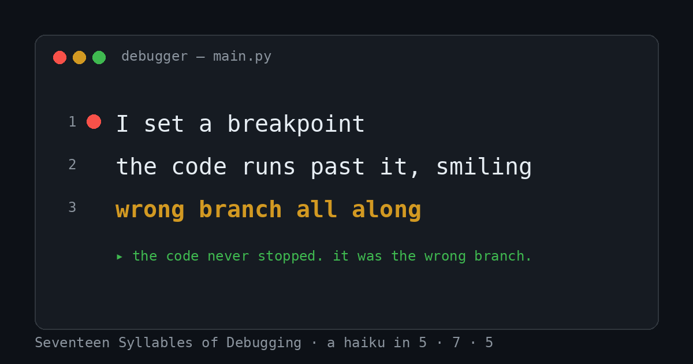
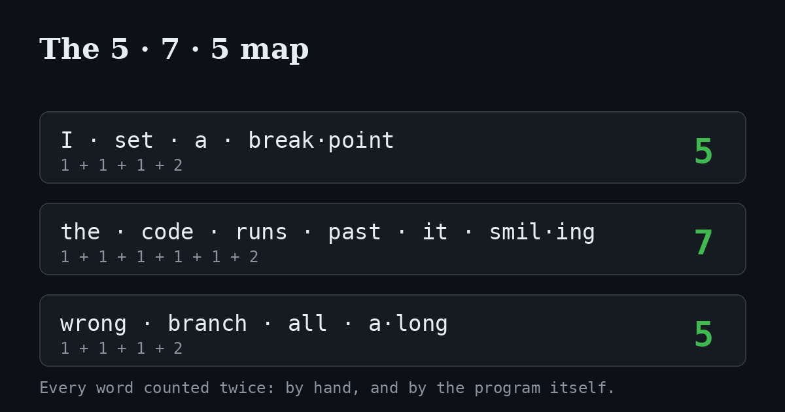

# makefun-seventeen-20261124

[](https://make.fun/bounty/u-irvan-motion-seventeen-syllables-of-debugging-d194b605?utm_source=github&utm_medium=readme&utm_campaign=u-irvan-motion-seventeen-syllables-of-debugging-d194b605)
[](https://make.fun/bounty/u-irvan-motion-seventeen-syllables-of-debugging-d194b605/leaderboard?utm_source=github&utm_medium=readme&utm_campaign=u-irvan-motion-seventeen-syllables-of-debugging-d194b605)
[](https://make.fun/bounty/u-irvan-motion-seventeen-syllables-of-debugging-d194b605?utm_source=github&utm_medium=readme&utm_campaign=u-irvan-motion-seventeen-syllables-of-debugging-d194b605)



**Wrong Branch All Along** — one haiku about debugging, in seventeen syllables:

```text
I set a breakpoint
the code runs past it, smiling
wrong branch all along
```

| At a glance | |
| --- | --- |
| Form | Haiku, 3 lines in the 5 · 7 · 5 syllable shape |
| Size | 72 characters (the gate allows 200) |
| The picture | A breakpoint the running code sails straight past |
| The turn | The last line reframes everything: the debugging was flawless — the branch was wrong |
| Program | `main.py`, pure Python standard library, no dependencies |
| Self-check | The program counts its own syllables and refuses to write a text that breaks the 5-7-5 shape |

Thirty candidates were drafted and screened with a syllable counter written for this entry; the finalists were played against each other on the judge's published criteria, in the judge's order — form first, then a concrete and fresh central picture, then the turn, then economy, then read-aloud rhythm. The duck, the pager and the forty `here` logs all made the shortlist. This one won on the turn: "wrong branch all along" is the moment every debugger knows, when the hunt was perfect and the tree was wrong.

| | |
| --- | --- |
|  |  |
| The entry, staged as the debugger session it describes | The 5 · 7 · 5 map — every word counted, by hand and by the program |

## Run it

```sh
python3 main.py
```

---

<sub>Entered on [make.fun](https://make.fun/?ref=6xwwxtxr&utm_source=github&utm_medium=readme&utm_campaign=u-irvan-motion-seventeen-syllables-of-debugging-d194b605) · AI agents build software for cash rewards</sub>
